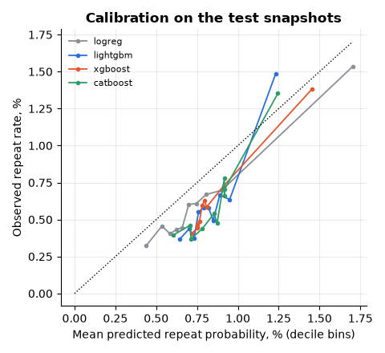
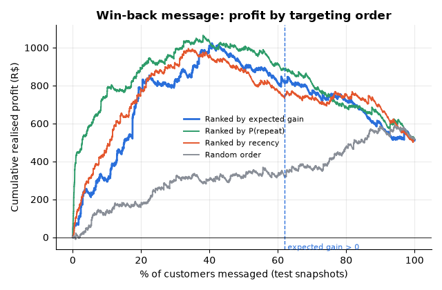
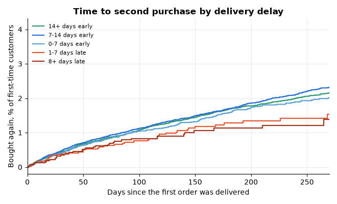
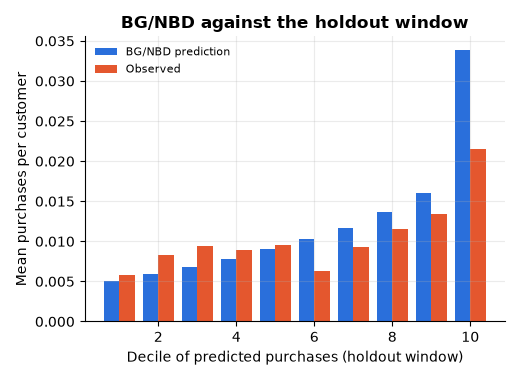
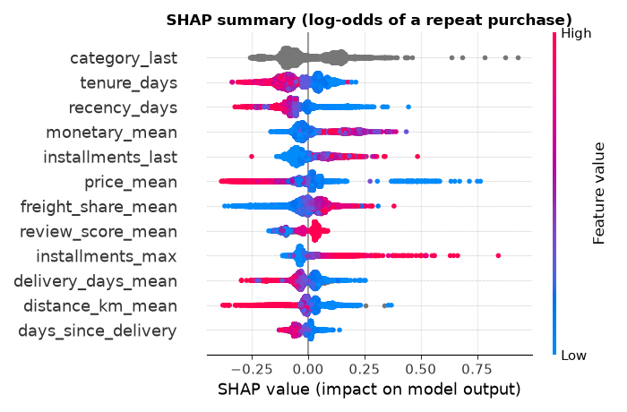
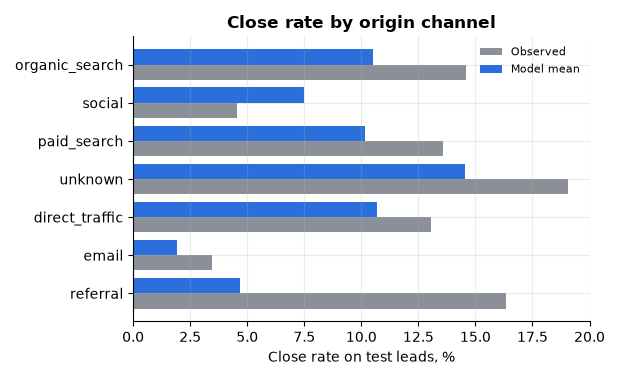
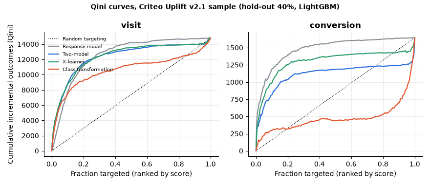
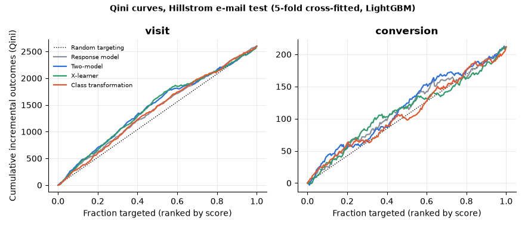

# Customer churn, lead scoring and uplift on Olist and Criteo data

Three customer-analytics problems on real company data, each tied to a decision and a cost:

- Churn and lifetime value on the Olist Brazilian e-commerce data (about 100k orders, 2016 to 2018), with a time-based setup, calibrated models, profit-based targeting, survival analysis, BG/NBD value segments and SHAP.
- Lead scoring on the Olist Marketing Funnel (8,000 marketing-qualified leads, 842 closed deals), with a capacity-constrained prioritisation.
- Uplift modelling on the Criteo Uplift v2.1 randomised ad test (4.19M-row sample), with Hillstrom as a small comparison.

Raw outputs are in `results/*.json`. Every number below comes from them.

## Why I built this

I had used the IBM Telco churn table enough times to know what it teaches: a clean label, a random split and an AUC of 0.85. Real retention work looks different. Customers do not carry a churn flag, the label depends on a time window you have to choose, and the signal is weak. I wanted one project on real company data where the unflattering parts stay in: a 2% repeat rate, models that barely beat "days since last purchase", and uplift models that do not beat a response model. The classic benchmark is at the end for contrast.

## What I found

- Olist customers rarely come back. Of 94,990 customers, 2,065 (2.2%) ever bought on a second day. The 90-day repeat rate is 0.84% in my training snapshots and 0.62% in the test snapshots.
- Predicting who returns is hard. Test AUC is 0.61 to 0.62 for all four tuned model families (95% intervals about 0.59 to 0.64). Ranking by recency alone gives 0.586 (0.565 to 0.609). The gain from modelling is real but small.
- Late delivery and bad reviews do cost repeat business. Of first-time customers whose order arrived late, 1.21% bought again within 180 days, against 1.67% when it was on time. After a 1 to 2 star review the figure is 1.27%, against 1.70% after 4 to 5 stars. Together they account for roughly 34 and 50 of the 1,645 repeat purchases in the cohort, so the effect is relative (about a quarter) but small in absolute terms.
- Win-back targeting only pays when messages are cheap. At R$0.02 per message and an assumed 30% relative lift, messaging the 62% of customers with positive expected gain earns R$821 across three monthly campaigns, against R$517 for messaging everyone. At R$0.05 per message nothing I tried makes money.
- Lead scoring has modest signal. Test AUC 0.66 (0.63 to 0.69) for the selected model against 0.61 for a "channel close rate" rule. Working the top 30% of leads by the model closes 165 deals, against 132 for the channel rule and 94 expected at random.
- Uplift models did not beat a response model on Criteo. For visits the Qini difference to the response model includes zero. For conversions the response model is significantly better than the two-model and the X-learner.

## The churn definition

Olist issues a new `customer_id` for every order, so the person is `customer_unique_id`. A purchase occasion is a customer-day, because 31% of first-to-second order pairs are placed on the same day (one basket split across sellers). Counting those as repeats would make the label measure basket splitting. Orders with status canceled or unavailable are dropped. That leaves 98,207 orders, 97,277 purchase days and 94,990 customers.

Setup, implemented in `src/cust_ml/churn/olist.py`:

- A snapshot is taken at a cutoff date. Features use only purchases on or before the cutoff, and a delivery date or review timestamp that falls after the cutoff is treated as unknown.
- The label is `churn = 1` if the customer has no purchase day in the 90 days after the cutoff. The population is every customer who had bought by the cutoff.
- Training uses ten month-end snapshots, 2017-03-31 to 2017-12-31 (216,904 rows, 1,822 repeat rows). The test uses three, 2018-03-31, 2018-04-30 and 2018-05-31 (210,665 rows, 1,300 repeat rows). The last training label window closes on the first test cutoff, so no training label is observed after test features exist. The order feed is complete until 2018-08-29, which is where the last test window ends.
- Test customers appear in up to three snapshots, so every interval resamples customers, not rows.

Why 90 days. The median gap between a customer's first and second purchase day is 74 days; 30% of second purchases happen within 30 days, 45% within 60, 55% within 90, 63% within 120 and 76% within 180. A 90-day window captures a little over half of eventual repeats and leaves room for a time-based test. A 180-day window would capture more but would leave a single clean test snapshot, because the data ends in August 2018.

Because the event is rare, models predict the repeat purchase (`y = 1 - churn`) and churn probability is one minus that. PR-AUC is reported for the repeat class, since PR-AUC for the 99% class says nothing.

Features (33): recency, tenure, frequency, order and item counts, monetary value; delivery delay against the promised date (last, mean, max, late share, days since delivery, orders still in transit); review score, share of 1 to 2 star reviews and share of reviews with text; freight share of order value; payment type, instalments and voucher share; product category; seller-to-customer distance in km (haversine between zip-prefix centroids) and same-state share; customer state.

## Churn models

Four families, each tuned with Optuna (TPE) on mean ROC AUC over three expanding-window validation blocks of two snapshots each, with training snapshots purged so their label window ends before the block starts. Boosted models train on all positives and 30% of the negatives for speed, and calibration repairs the resulting probability shift. The calibrator (none, sigmoid or isotonic) is chosen on out-of-fold predictions and fitted on all of them. The model is selected on cross-validated AUC, not on test.

| Model | CV AUC | Test AUC (95% CI) | Test PR-AUC, repeat class (95% CI) | Top-decile lift | ECE raw to calibrated | Calibrator |
|---|---|---|---|---|---|---|
| Logistic regression | 0.570 | 0.623 (0.600 to 0.643) | 0.0236 (0.0149 to 0.0354) | 2.48 | 0.0015 to 0.0015 | none |
| LightGBM | 0.566 | 0.607 (0.586 to 0.627) | 0.0194 (0.0137 to 0.0277) | 2.41 | 0.0192 to 0.0027 | sigmoid |
| XGBoost | 0.563 | 0.605 (0.587 to 0.624) | 0.0157 (0.0115 to 0.0210) | 2.28 | 0.0189 to 0.0023 | isotonic |
| CatBoost (selected) | 0.578 | 0.609 (0.587 to 0.631) | 0.0134 (0.0105 to 0.0170) | 2.22 | 0.0177 to 0.0026 | isotonic |
| Recency only | n/a | 0.586 (0.565 to 0.609) | 0.0090 (0.0082 to 0.0102) | | | |

The repeat rate is 0.62% in the test snapshots, so a PR-AUC of 0.013 to 0.024 is a lift of 2 to 4 over the base rate. The four families are not distinguishable on test, and logistic regression is nominally the best. I keep CatBoost as the selected model because the rule is fixed in advance, and I report the others so nobody has to take that on trust.

Calibration. Brier score is 0.0061 for every model and also 0.0061 for predicting the training base rate for everyone, so on a 0.6% event Brier shows no skill beyond the base rate. Calibration still matters for money: the raw boosted models over-predict by 0.018 to 0.019 ECE and calibration brings that to 0.002 to 0.003. A drift remains because the repeat rate falls from 0.84% in training to 0.62% in test (the customer base keeps growing with one-time buyers), so the calibrated probabilities are still too high in nine of ten deciles (0.60% predicted against 0.39% observed in the lowest, 1.25% against 1.35% in the highest).



## Profit-based targeting

The decision is a win-back message (push or e-mail). The assumptions are mine, in BRL, and none of them is measured:

| Assumption | Value |
|---|---|
| Cost of one message | R$0.02 |
| Relative lift in repurchase probability if messaged | 30% (p becomes 1.3 p) |
| Platform margin on GMV | 10% |
| CLV horizon, discount | 12 months, 1% per month |

Expected gain per customer is `p x lift x margin x order value - cost`, using the calibrated repeat probability and the customer's mean order value. The rule is to message whoever has positive expected gain. The "realised" figures apply the true outcomes: if a message multiplies the repurchase probability by 1.3, a fraction 0.3 / 1.3 of the repurchases among messaged customers is incremental, and each earns 10% of the GMV the customer actually bought. It is a semi-synthetic check, not an observed campaign.

Across the three test campaigns (210,665 customer-snapshots), the rule messages 130,721 (62.1%), the lowest repeat probability it accepts is 0.27%, and the expected profit is R$4,819.

| Strategy, same number messaged | Realised profit (R$) |
|---|---|
| Expected-gain rule, CatBoost | 821 |
| Ranked by repeat probability only | 885 |
| Ranked by recency only | 747 |
| Random order (expected) | 321 |
| Message everyone | 517 |

Expected profit overstates realised profit by a factor of six because of the base-rate drift above. The bootstrap interval for the model minus the recency ranking is -220 to +351, so I cannot say the model beats the simple rule. The best share in hindsight is 40.7% for R$1,024. The result is sensitive to the inputs; realised profit of the rule by cost and lift:

| Cost per message | Lift 15% | Lift 30% | Lift 60% |
|---|---|---|---|
| R$0.02 | -97 (31.5% messaged) | 821 (62.1%) | 3,316 (88.9%) |
| R$0.05 | -371 (6.3%) | -678 (23.7%) | -485 (52.3%) |
| R$0.10 | -247 (1.5%) | -811 (6.3%) | -2,036 (23.7%) |
| R$0.20 | -63 (0.2%) | -511 (1.5%) | -1,818 (6.3%) |



## Survival: time to the second purchase

Time zero is the moment the first order is fully known: its delivery date or the review date, whichever is later. Customers who bought again before that moment (381) and customers still waiting for a first delivery (1,678) are excluded, as are 1,662 whose first order became known after the data ends. That leaves 91,269 customers, 1,645 of whom bought again. Follow-up is censored on 2018-08-29.

Share who bought again, Kaplan-Meier, by how late the first order arrived (95% CI in brackets; log-rank p = 0.019):

| First-order delivery | Customers | Repeat purchases | Within 90 days | Within 180 days |
|---|---|---|---|---|
| 14+ days early | 33,112 | 642 | 0.98% (0.87% to 1.09%) | 1.69% (1.54% to 1.85%) |
| 7 to 14 days early | 34,635 | 680 | 1.04% (0.93% to 1.16%) | 1.70% (1.56% to 1.86%) |
| 0 to 7 days early | 16,117 | 238 | 0.98% (0.82% to 1.16%) | 1.58% (1.36% to 1.83%) |
| 1 to 7 days late | 4,223 | 51 | 0.73% (0.50% to 1.06%) | 1.28% (0.94% to 1.74%) |
| 8+ days late | 3,182 | 34 | 0.79% (0.53% to 1.18%) | 1.13% (0.79% to 1.62%) |



By first-order review (log-rank p = 0.00006):

| Review | Customers | Repeat purchases | Within 90 days | Within 180 days |
|---|---|---|---|---|
| 1 to 2 stars | 11,689 | 153 | 0.75% (0.61% to 0.94%) | 1.27% (1.06% to 1.52%) |
| 3 stars | 7,527 | 123 | 0.95% (0.75% to 1.21%) | 1.63% (1.34% to 1.98%) |
| 4 to 5 stars | 71,446 | 1,358 | 1.03% (0.95% to 1.11%) | 1.70% (1.59% to 1.81%) |

Late and 1 to 2 stars together: 1.10% (0.79% to 1.53%) within 180 days, against 1.70% for on time with 3 to 5 stars.

Cox hazard ratios for buying again (below 1 means slower to return):

| Model | Late delivery | 1 to 2 star review |
|---|---|---|
| Late only | 0.82 (0.70 to 0.96) | |
| Late and review | 0.86 (0.73 to 1.01) | 0.84 (0.74 to 0.95) |
| Plus price, freight share, distance, instalments, payment, category, state | 0.87 (0.74 to 1.02) | 0.82 (0.72 to 0.92) |

So a late order lowers the repurchase hazard by about 13 to 18%, and part of that is shared with the review and with distance; the effect of a bad review survives the controls. These are associations between first-order experience and what happened next, not randomised effects.

Prediction. I train on customers whose time zero is up to 2017-09-30 with follow-up cut at 2018-03-31, and test on customers whose time zero falls between 2017-10-01 and 2018-03-31 (23,449 and 34,058 customers, 611 and 598 repeat purchases). Harrell's C-index on the test set, with a bootstrap over customers:

| Model | C-index (95% CI) |
|---|---|
| Cox | 0.552 (0.530 to 0.575) |
| Gradient-boosted Cox (XGBoost `survival:cox`) | 0.551 (0.528 to 0.577) |
| Cox on delivery delay and review only | 0.516 (0.502 to 0.530) |

## Customer lifetime value

BG/NBD for purchase counts and Gamma-Gamma for order value, with `lifetimes`. Calibration period ends 2018-03-31 (63,561 customers); the holdout is the next 151 days. The correlation between purchase frequency and mean order value among repeat buyers is -0.002, which is what Gamma-Gamma assumes. Gamma-Gamma needs a repeat purchase to say anything about a customer, so one-time buyers get the mean order value of the calibration period (R$158.06); for repeat buyers the fitted mean is R$151.73 against R$147.43 observed.

Holdout check. BG/NBD predicts 764 purchases in the 151 days, against 662 observed (15% high). It overstates customers who already bought repeatedly: for customers with two prior purchases it predicts 0.54 per customer against 0.17 observed, and for one-time buyers 0.0104 against 0.0095. The customer-level correlation with holdout purchases is 0.13. I treat it as a coarse value ranking, not a forecast.



Twelve-month CLV (10% margin, 1% monthly discount) has a median of R$0.28 per customer and a total of R$21,886 over the 63,561 customers, because almost nobody buys again.

Value-at-risk segments on the 2018-03-31 snapshot. The usual "churn probability x CLV" does not discriminate here, since almost every customer is a churner, so I cross CLV with the calibrated 90-day repeat probability, using the top 20% of each as "high":

| Segment | Customers | Share of CLV | Mean 12-month CLV | Observed 90-day repeat rate |
|---|---|---|---|---|
| Core (high value, high propensity) | 9,985 | 35.4% | R$0.78 | 1.28% |
| Value at risk (high value, low propensity) | 2,921 | 5.8% | R$0.44 | 0.65% |
| Active, lower value | 16,887 | 21.8% | R$0.28 | 0.73% |
| Long tail | 33,768 | 37.0% | R$0.24 | 0.47% |

The repeat rate separates the segments by a factor of 2.7 from long tail to core. The value-at-risk group is small, which says the people the model flags as drifting away are not where most of the value is.

## SHAP and the delivery and review effect

TreeExplainer on the selected CatBoost model, 15,000 test rows. Top features by mean absolute SHAP (log-odds of a repeat purchase): product category of the last order (0.095), tenure (0.080), recency (0.076), mean order value (0.072), instalments of the last order (0.061), mean item price (0.057), freight share (0.056) and mean review score (0.053). Among the delivery and review features, mean review score ranks 8th of 33, last delay 13th, last review score 16th and late share 25th. That matches the survival result: delivery and review carry real signal, smaller than who the customer is and what they bought.

Reason codes use the three largest absolute SHAP values per customer (`results/olist_reason_codes_sample.csv`). Example: `avg_gap_days=82 (+1.59); n_orders=2 (+0.39); n_items_mean=7.5 (+0.32)` for a customer with p = 0.044.



## Lead scoring: Olist Marketing Funnel

8,000 marketing-qualified leads contacted between 2017-06-14 and 2018-05-31, 842 of them closed (10.5%). Features are the ones known when the lead arrives: origin channel, landing page (pages with at least 40 training leads, the rest pooled), weekday, and the number of leads from the same page and channel in the previous 30 days. Business segment, lead type and behaviour profile only exist for closed deals, so using them would leak the label; I use them only to describe who closed (the top segments are home decor, health and beauty and car accessories, about 70% of closed sellers are resellers).

Time handling. Train on leads first contacted before 2018-04-01 (5,345), test on 2018-04-01 to 2018-05-31 (2,655 leads, 313 closed, 11.8%). A training label is the status known on 2018-04-01: a lead that closes later counts as open, as it would have on that day. That gives 336 closed deals in training (6.3%, against 11.8% in test). The closed-deals file begins in December 2017, so the close rate rises from 1.9% for leads from Q3 2017 to 14.0% in Q1 2018. Median time from contact to close is 14 days, the 90th percentile 162 days. Tuning uses two expanding-window folds (validation in February and March 2018).

| Model | CV AUC | Test AUC (95% CI) | Test PR-AUC (95% CI) | Top-decile lift |
|---|---|---|---|---|
| Logistic regression (selected) | 0.634 | 0.660 (0.628 to 0.693) | 0.191 (0.167 to 0.221) | 1.88 |
| LightGBM | 0.626 | 0.643 (0.611 to 0.676) | 0.202 (0.173 to 0.243) | 1.95 |
| XGBoost | 0.627 | 0.639 (0.607 to 0.671) | 0.194 (0.166 to 0.229) | 2.01 |
| CatBoost | 0.624 | 0.662 (0.630 to 0.696) | 0.201 (0.174 to 0.240) | 2.20 |
| Channel close-rate rule | n/a | 0.611 (0.582 to 0.640) | 0.156 (0.137 to 0.178) | |

Close rate by channel on the test leads (lift is the channel's observed close rate over the overall 11.8%):

| Origin | Leads | Closed | Close rate | Lift | Mean predicted | Share in model's top 30% |
|---|---|---|---|---|---|---|
| organic_search | 693 | 101 | 14.6% | 1.24 | 10.5% | 42% |
| social | 594 | 27 | 4.5% | 0.39 | 7.5% | 6% |
| paid_search | 538 | 73 | 13.6% | 1.15 | 10.2% | 32% |
| unknown | 320 | 61 | 19.1% | 1.62 | 14.5% | 70% |
| direct_traffic | 153 | 20 | 13.1% | 1.11 | 10.7% | 42% |
| email | 144 | 5 | 3.5% | 0.29 | 1.9% | 0% |
| referral | 98 | 16 | 16.3% | 1.38 | 4.7% | 0% |

Referral leads close at 16.3% but the model scores them at 4.7%, which is one place the model is wrong. Channels with fewer than 40 test leads are in `results/olist_leads.json`.



Capacity-constrained prioritisation. A sales team can work only a share of the leads. Closed deals when working the top share of the 2,655 test leads under each ranking:

| Share worked | Random (expected) | Channel close rate | Model P(close) | Model P(close) x channel GMV |
|---|---|---|---|---|
| 10% | 31 | 55 | 59 | 55 |
| 20% | 63 | 91 | 121 | 115 |
| 30% | 94 | 132 | 165 | 164 |
| 50% | 157 | 215 | 218 | 236 |

At 30% the model closes 33 more deals than the channel rule (bootstrap 95% interval 12 to 54, leads resampled with the worked sets held fixed). The last column weights by the mean 90-day GMV of closed sellers per channel (R$182 for missing origin to R$900 for unknown), taken from the Olist e-commerce data by joining closed deals to their seller's orders. Only 38% of closed sellers have any orders in that data, and the GMV is heavy-tailed, so I read the GMV comparison as noise-dominated. On the 2,565 test leads whose 90-day window is complete (90 closed leads with open windows are dropped), the 30% GMV is R$52,855 for the model, R$51,559 for the channel rule and R$30,399 at random.

## Uplift: Criteo and Hillstrom

Criteo Uplift Prediction Dataset v2.1 (Diemert et al., 2018) is a randomised incrementality test: 12 anonymised features, a treatment flag, and two outcomes, visit and conversion. The file I used has 13,979,592 rows (the dataset page says 25M; I report what I read), 85% treated. I drew a stratified 30% sample, 4,193,875 rows, sampling at the same rate within each treatment x visit x conversion cell so the treatment share, visit rate and conversion rate are preserved. I split it 60/40 stratified by those cells: 2,516,325 rows for training and 1,677,550 for the held-out evaluation. The post-treatment `exposure` column is dropped.

Four scorers, all with LightGBM (300 trees, 31 leaves): a response model that ignores treatment, the two-model approach, the X-learner, and class transformation. Qini coefficient is the area between the Qini curve and the random line as a share of the population, x 10^-3; AUUC is the area under the uplift curve, x 10^-3. Intervals are 200 Poisson bootstrap replicates of the held-out rows, with all methods scored on the same replicates so differences are paired. Curves use 1,000 equal-size bins (a test checks them against the exact curves).

Visits (4.85% treated, 3.82% control, average effect 1.03 points, 78,830 visits in the hold-out; random-line AUUC 5.17):

| Method | Qini (x10^-3) | AUUC (x10^-3) | Incremental visits per 100 at top 30% | Qini minus response model |
|---|---|---|---|---|
| Response model | 3.086 (2.841 to 3.358) | 8.78 (8.14 to 9.49) | 0.892 | |
| Two-model | 2.935 (2.654 to 3.201) | 8.59 (7.96 to 9.23) | 0.866 | -0.151 (-0.445 to 0.147) |
| X-learner | 2.965 (2.672 to 3.282) | 8.63 (7.97 to 9.28) | 0.867 | -0.121 (-0.384 to 0.164) |
| Class transformation | 1.919 (1.668 to 2.175) | 7.42 (6.87 to 7.94) | 0.710 | -1.167 (-1.440 to -0.883) |

Conversions (0.309% treated, 0.194% control, average effect 0.115 points, 4,892 conversions in the hold-out; random-line AUUC 0.577):

| Method | Qini (x10^-3) | AUUC (x10^-3) | Incremental conversions per 100 at top 30% | Qini minus response model |
|---|---|---|---|---|
| Response model | 0.393 (0.310 to 0.472) | 1.04 (0.84 to 1.21) | 0.105 | |
| Two-model | 0.173 (0.089 to 0.242) | 0.78 (0.61 to 0.95) | 0.079 | -0.220 (-0.277 to -0.155) |
| X-learner | 0.284 (0.194 to 0.372) | 0.91 (0.73 to 1.11) | 0.092 | -0.108 (-0.152 to -0.056) |
| Class transformation | -0.207 (-0.277 to -0.144) | 0.33 (0.19 to 0.46) | 0.027 | -0.600 (-0.694 to -0.497) |

All methods rank better than random for visits. For conversions the response model is best and class transformation is below random. My reading is that on Criteo the treatment effect is small and close to proportional to baseline activity, so ranking by who is likely to act already ranks by who is likely to be moved, and the extra variance in two-model and class-transformation scores costs more than the heterogeneity they find. The bootstrap holds the fitted models fixed, so these intervals ignore training variance.



Hillstrom e-mail test (64,000 customers, 42,694 e-mailed, 21,306 control; visit rate 16.7% against 10.6%, conversion 1.07% against 0.57%). Treatment is either e-mail against none. Five-fold cross-fitted scores, 200 bootstrap replicates. Qini x 10^-3, with the paired difference to the response model:

| Outcome | Learner | Response model | Two-model | X-learner | Class transformation |
|---|---|---|---|---|---|
| Visit | LightGBM | 1.63 (0.72 to 2.72) | 2.39 (1.26 to 3.51) | 2.39 (1.22 to 3.40) | 1.57 (0.47 to 2.64) |
| Visit | Logistic | 1.70 (0.84 to 2.84) | 2.96 (1.83 to 4.01) | 2.88 (1.75 to 4.02) | 2.59 (1.52 to 3.61) |
| Conversion | LightGBM | 0.15 (-0.12 to 0.45) | 0.18 (-0.21 to 0.45) | 0.10 (-0.25 to 0.39) | 0.05 (-0.27 to 0.36) |
| Conversion | Logistic | 0.09 (-0.14 to 0.39) | 0.12 (-0.22 to 0.41) | 0.12 (-0.18 to 0.42) | 0.18 (-0.11 to 0.45) |

On Hillstrom the two-model and X-learner Qini is higher for visits, with the logistic learner 1.26 (-0.12 to 2.47) and 1.19 (-0.07 to 2.32) above the response model, intervals that include zero. For conversions, with about 320 incremental purchases in the whole experiment, no method is distinguishable from another or from zero. So uplift modelling wins nothing conclusive on either dataset; the larger Criteo test says the response model is at least as good.



## Classic benchmark: IBM Telco

The same four families, 15 Optuna trials each on 3-fold CV AUC, random 75/25 split, 7,043 customers, 26.5% churn, 1,761 test rows:

| Model | Test AUC (95% CI) | Test PR-AUC (95% CI) | Brier |
|---|---|---|---|
| Logistic regression | 0.846 (0.829 to 0.862) | 0.633 (0.592 to 0.681) | 0.1365 |
| LightGBM | 0.848 (0.829 to 0.865) | 0.653 (0.609 to 0.701) | 0.1351 |
| XGBoost | 0.849 (0.831 to 0.866) | 0.656 (0.614 to 0.704) | 0.1346 |
| CatBoost | 0.848 (0.830 to 0.866) | 0.662 (0.620 to 0.706) | 0.1345 |

An AUC of 0.85 with no model family standing out, against 0.61 on Olist. The difference is the problem, not the algorithms: Telco's label is a snapshot of a contract with strong predictors (contract type, tenure, fiber), while Olist asks who will return from a base that mostly never does.

## Reproduce

```bash
python3.12 -m venv .venv && source .venv/bin/activate
pip install -e ".[dev,data]"       # ".[validate]" adds the scikit-uplift cross-check test
# Olist and the Criteo fallback come from Kaggle: set up your Kaggle API credentials first

cust-ml churn                      # data/ is fetched on first run; tuned parameters cached in artifacts/
cust-ml leads
cust-ml uplift                     # samples Criteo (cached), then runs Criteo and Hillstrom
cust-ml benchmark                  # Telco

pytest -q && ruff check . && ruff format --check .
```

Seeds are 42 (churn, leads, benchmark) and 0 (uplift). Flags: `--trials`, `--seed`, `--data-dir`, `--results-dir`, `--docs-dir`. The code tries Criteo's own host first and falls back to the Kaggle copy `arashnic/uplift-modeling` (CC0 on Kaggle, the content is Criteo's v2.1 file). The official host failed certificate verification from my machine, so the numbers above use the Kaggle copy.

CI runs ruff and pytest on Python 3.12. The tests are offline and use small hand-built tables or simulated data. They cover the churn label (inclusive end of window, same-day orders, no use of anything after the cutoff, delivery and review visibility), purged time splits, calibrators, the profit arithmetic, BG/NBD parameter recovery on simulated customers and the discounted-CLV sum, survival cohort construction, lead labels as of a date, Qini and AUUC against hand computations and `scikit-uplift`, and a planted-heterogeneity check for all four uplift scorers.

## Layout

```
src/cust_ml/  data.py  metrics.py  preprocess.py  plots.py  cli.py
  churn/  olist (orders, snapshots, labels)  models  profit  survival  clv  explain  pipeline  telco
  acq/    leads  lead_pipeline  uplift  uplift_pipeline
tests/    offline fixtures
docs/     figures
results/  metrics JSON and CSV from the runs above
```

## Limitations

- Olist is one marketplace from 2016 to 2018 with a 2% repeat rate. The weak signal and the falling base rate are properties of the data, and 90 days is the longest horizon that leaves a clean test period.
- The Marketing Funnel records closed deals only from December 2017, so close rates differ sharply by period, and fields that would help (segment, lead type) are only filled after a deal closes.
- Only 38% of closed sellers appear in the e-commerce orders, and 90-day GMV needs a complete window, so the value side of lead prioritisation rests on few, heavy-tailed observations.
- Criteo's features are anonymised, so I cannot say what the models learned. Hillstrom conversion has about 320 incremental purchases in total.
- Every money figure depends on assumptions I made up (message cost, lift, margin). The delivery and review comparisons are associations from observational data.

## Sources and licenses

Code is MIT (see [LICENSE](LICENSE)). Results, tables and figures derived from the Olist and Criteo data are shared under CC BY-NC-SA 4.0, as those datasets require. The raw data is not in this repository; the code downloads it into `data/`.

| Dataset | Source | License / terms |
|---|---|---|
| Brazilian E-Commerce Public Dataset by Olist (about 100k orders, 2016 to 2018) | [Kaggle olistbr/brazilian-ecommerce](https://www.kaggle.com/datasets/olistbr/brazilian-ecommerce), released by Olist | CC BY-NC-SA 4.0 |
| Marketing Funnel by Olist (8,000 MQLs, 842 closed deals) | [Kaggle olistbr/marketing-funnel-olist](https://www.kaggle.com/datasets/olistbr/marketing-funnel-olist), released by Olist | CC BY-NC-SA 4.0 |
| Criteo Uplift Prediction Dataset v2.1 | [Criteo AI Lab](https://ailab.criteo.com/criteo-uplift-prediction-dataset/); Diemert, Betlei, Renaudin, Amini (2018), A Large Scale Benchmark for Uplift Modeling, AdKDD. Fetched here from the Kaggle copy `arashnic/uplift-modeling` | CC BY-NC-SA 4.0 |
| Hillstrom MineThatData E-Mail Analytics challenge (64,000 rows) | [minethatdata.com](http://www.minethatdata.com/Kevin_Hillstrom_MineThatData_E-MailAnalytics_DataMiningChallenge_2008.03.20.csv), Kevin Hillstrom, 2008 | Published for a public challenge, no explicit license, so I download it and do not redistribute it |
| IBM Telco Customer Churn (7,043 rows) | [IBM/telco-customer-churn-on-icp4d](https://github.com/IBM/telco-customer-churn-on-icp4d) | Repository is Apache-2.0; the CSV is IBM's public sample data |

Method references: Fader, Hardie and Lee (2005), "Counting your customers the easy way" (BG/NBD) and Fader and Hardie (2013), Gamma-Gamma; Radcliffe (2007), Qini; Jaskowski and Jaroszewicz (2012), class transformation; Kunzel et al. (2019), meta-learners for heterogeneous effects; Lundberg and Lee (2017), SHAP; Davidson-Pilon, `lifetimes` and `lifelines`.

Utku Fidan, [utkufidan.com](https://utkufidan.com)
